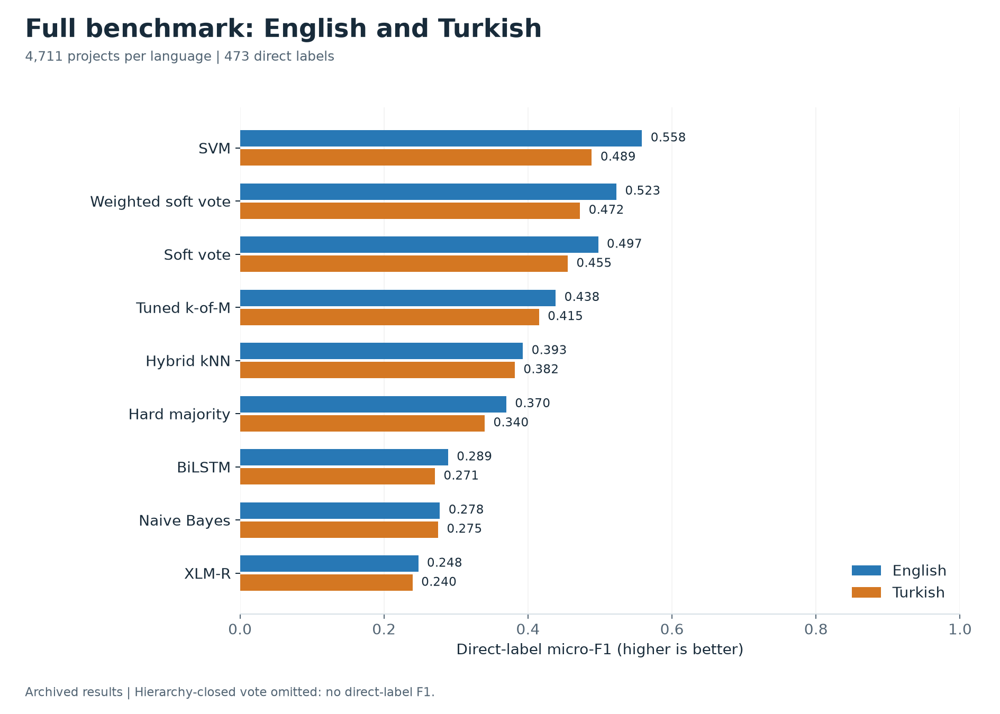

# NALTRA

**Natural Language Analysis & Taxonomy Robust Architecture** classifies EU research
project objectives into scientific fields using the EuroSciVoc taxonomy. It compares
individual models and ensembles on English, translated Turkish, synthetic
code-switched text, and noisy text, with near-OOD rejection, calibration and latency.

The benchmark contains **31,407 projects**, **473 direct labels**, and a **586-node
hierarchy**. Projects share the same train, validation, and test assignment across
language variants.

[Documentation](docs/README.md) · [Results](docs/results.md) ·
[Interactive dashboard](docs/results/index.html) · [Reproduction guide](docs/reproducibility.md)

## What is new

- **Data: the NALTRA CORDIS EN-TR benchmark, release 1.1.0** (CC BY 4.0,
  [data/LICENSE](data/LICENSE)). All 31,407 labelled CORDIS Horizon 2020 project objectives
  in English and in machine-translated Turkish (283,002 aligned sentence pairs), two
  synthetic EN-TR code-switch tracks (sentence- and chunk-level; validation and test) and a
  seeded noisy EN/TR test track (generated locally, not shipped). All tracks share one
  project-grouped, duplicate-aware split (21,985 / 4,711 / 4,711) and the same labels, and
  every shipped split is locked by the SHA-256 in its manifest ([dataset card](data/README.md),
  [dataset guide](docs/dataset.md)).
- **Task: hierarchical multi-label classification under input shift, with rejection**
  ([Task](#task)): 473 direct labels in a 586-node tree, the same projects in four input
  conditions, near-OOD rejection, and course baselines vs new methods (sparse+dense RRF kNN,
  zero-shot Kev/Jev/Laya, NALTRA votes). Unlike flat, single-label categorisation, 84.3% of
  projects carry several labels and 59.8% span several roots.
- **Why Turkish.** It is agglutinative and morphologically rich (one stem takes many suffixed
  word forms), a hard case for word-level features; and we are not aware of any
  EuroSciVoc-labelled Turkish corpus.
- **Closest prior work.** EURLEX57K (Chalkidis et al. 2019: 57k English EU laws, about 4.3k
  EuroVoc labels) and MultiEURLEX (Chalkidis et al. 2021: 65k EU laws officially translated
  into 23 EU languages, EuroVoc labels, zero-shot cross-lingual transfer) are the closest
  resources we know of. NALTRA does not replace them; it differs in scope: research-project
  objectives labelled with the EuroSciVoc science taxonomy; Turkish, not an EU language,
  machine-translated rather than officially translated; synthetic code-switch and noisy
  copies paired with the same projects; near-OOD rejection; and zero-shot decision models
  against trained ones. Its trained members see Turkish in training, so EN -> TR is not
  zero-shot cross-lingual transfer.

Research questions:

1. *Which trained model fits 473 hierarchical labels best, and do votes help?* A calibrated
   linear SVM: 0.558 EN / 0.489 TR micro-F1, 0.668 hierarchical F1; no vote beats it (best:
   weighted soft vote, 0.523 / 0.472) ([full benchmark](docs/results.md#full-benchmark)).
2. *How much is lost on translated, code-switched and noisy input?* SVM loses 0.070 (-> TR),
   0.050 (-> sentence-level code-switch) and 0.078 (-> noisy EN), the multilingual hybrid kNN
   0.011, 0.009 and 0.019; SVM's drop is larger than every other member's in each tested
   condition (Holm p 0.0008), though Naive Bayes and XLM-R drop less than kNN on TR (point
   estimates, not tested) ([robustness](docs/results.md#language-and-noise-robustness)).
3. *Can confidence identify humanities-only projects after training excludes projects
   carrying retained humanities labels?* A retrained SVM reaches AUROC 0.927 EN / 0.924 TR
   (94 OOD vs 4,351 in-domain projects). Sub-threshold humanities codes remain in 165
   training, 19 validation and 34 nominally in-domain test projects, so this holds out
   retained labels, not the whole field ([OOD](docs/results.md#out-of-distribution-detection)).
4. *Do zero-shot decision models match trained ones?* On the 120-pair sample Jev cannot be
   separated from XLM-R, BiLSTM or Naive Bayes, nor Kev from XLM-R, all far below SVM
   (0.556); Laya scores 0.068 EN, a negative result. Observed pairwise micro-F1 intervals have
   average half-widths of about 0.043 EN and 0.041 TR; small differences remain uncertain
   ([fixed sample](docs/results.md#fixed-sample-comparison)).

## Task

Given the objective text of an EU research project, predict every EuroSciVoc field it
belongs to:

- **Ancestor-consistent multi-label output** over the 473 direct labels of a 586-node,
  6-root tree up to 7 levels deep: 3.2 direct labels per project on average, 10.2 with
  ancestors ([statistics](docs/dataset.md#labels-and-splits)). Hierarchical F1 scores the
  ancestor-closed sets; the hierarchy-closed vote is ancestor-consistent by construction.
- **Long-tail labels.** Median label support is 126 projects and 176 labels have fewer than
  100, so macro-F1 is reported next to micro-F1.
- **Paired input shift.** The same test projects are scored in English, machine-translated
  Turkish, synthetic EN/TR code-switched text and noisy copies; each drop is a paired
  bootstrap difference. Locally trained members see EN+TR training text, so EN -> TR
  measures the gap on translated input.
- **Near-OOD rejection.** Training excludes every project carrying a retained humanities
  label, and a model must flag the humanities-only test projects by low confidence (AUROC,
  FPR@95%TPR).
- **Calibration** (ECE, Brier) and **latency**.
- **Zero-shot vs trained.** Kev, Jev (one yes/no question per label) and Laya (one
  two-option question per label) are not trained or fine-tuned on CORDIS by the team
  (provider pretraining data unknown) and face every trained member on 120 test pairs.

## Quick start

Run commands from the repository root. Python 3.11+ is supported; Python 3.13 is
recommended for the pinned experiment environment.

Create an environment:

```bash
python -m venv .venv
```

Activate it using the command for your shell:

| Shell | Command |
| --- | --- |
| Windows PowerShell | `.\.venv\Scripts\Activate.ps1` |
| Linux/macOS shell | `source .venv/bin/activate` |

Install the development package, restore the committed datasets, and validate them:

```bash
python -m pip install -e ".[dev]"
python scripts/unpack_data.py
python scripts/validate_datasets.py --prebuilt-release
python -m pytest
```

These steps need no model artifacts or API credentials. On Windows, run the tests one
file per process ([why](CONTRIBUTING.md#development-setup)). For the original experiment
dependency versions, a CPU-only PyTorch, and a CPU-only re-run of the Naive Bayes and SVM
results, follow the [reproduction guide](docs/reproducibility.md#environment).

## Classify a project

Place the shared SVM artifact in the folder shown in the [artifact guide](models/README.md),
then run:

```bash
python scripts/classify.py --artifacts models/cordis_v1.1.0/cordis_h2020/en_tr_direct --models svm --benchmark-settings results/metrics/cordis_v1.1.0_ensemble/summary.json --text "This project develops laser sensors for environmental monitoring."
```

The output is one JSON object containing selected labels, ancestor labels, detected
language, and the out-of-distribution decision. The benchmark settings load the
published threshold and verify the artifact fingerprints before inference.

See [model usage](docs/core_ml.md) for Python examples, ensembles, batch input, and
Kev/Jev/Laya setup.

## Models

| Model | Role | Approach | Evaluation |
| --- | --- | --- | --- |
| Naive Bayes | baseline | TF-IDF with one classifier per label | Full benchmark; non-voting baseline |
| SVM | baseline | TF-IDF with calibrated linear SVMs | Full benchmark |
| Hybrid kNN | new | TF-IDF and multilingual-e5 retrieval, reciprocal rank fusion | Full benchmark |
| BiLSTM | baseline | Learned embeddings and bidirectional LSTM | Full benchmark |
| Transformer | baseline | Fine-tuned XLM-RoBERTa | Full benchmark |
| Kev | new | Local zero-shot yes/no service | Fixed EN/TR samples |
| Jev | new | Hosted zero-shot yes/no service | Fixed EN/TR samples |
| Laya | new | Local zero-shot choice-question checkpoint | Fixed EN/TR samples; scored, never votes |
| NALTRA votes | new | Hard and soft votes over member scores | Full benchmark and fixed samples |

Hard and soft ensembles are evaluated offline from saved prediction matrices.
Locally trained models see both EN and TR training records. Their EN-to-TR comparison
measures performance on translated input, rather than zero-shot language transfer.
Roles are fixed in `configs/benchmark.yaml`; settings are in
[model configurations](docs/evaluation.md#model-configurations).

## Results

Reported micro-F1 on the full test sets, with 4,711 projects per language:

| System | English | Turkish |
| --- | --- | --- |
| SVM | **0.558** | **0.489** |
| Weighted soft ensemble | 0.523 | 0.472 |
| Hybrid kNN | 0.393 | 0.382 |
| BiLSTM | 0.289 | 0.271 |
| Naive Bayes | 0.278 | 0.275 |
| Transformer | 0.248 | 0.240 |



SVM is the strongest member across the six tested input conditions; none of the
tested ensembles beats it. Full tables, uncertainty intervals, sample comparisons,
error analysis, and limitations are in [Results](docs/results.md). Machine translation,
synthetic input variants, and a single training seed limit the conclusions.

## Reproduce

The raw archive, compressed dataset splits, manifests, taxonomy, and small result
summaries are committed. Trained models and prediction dumps are distributed separately
and installed at documented paths.

The [reproduction guide](docs/reproducibility.md) distinguishes recalculating metrics,
rerunning inference, and retraining. From a clone alone, the Naive Bayes and SVM rows,
their intervals and their near-OOD results can be regenerated on CPU
([CPU check](docs/reproducibility.md#cpu-check-naive-bayes-and-svm)); every other table can
be checked against the committed summaries. Publishing the artifact bundles and their
checksum list remains pending. Download links will be added when the release bundles are
available.

## Repository map

| Path | Purpose |
| --- | --- |
| `src/naltra/data/` | Preparation: cleaning, splitting, translation, code-switch, noise, manifests, release audits, JSONL loading |
| `src/naltra/models/` | Shared `BaseNALTRAModel` contract, classical, neural and service bases, one package per member (`laya/` wraps the pinned local checkpoint) |
| `src/naltra/pipeline/` | Inference: normalisation, language detection, thresholds, hierarchy paths, OOD, ensemble voting |
| `src/naltra/evaluation/` | Metrics, hierarchical metrics, calibration, OOD, bootstrap and Holm, threshold tuning over dumps, latency, figure data, the resumable prediction cache of `evaluate_all.py` |
| `src/naltra/reporting/` | HTML template of the results page |
| `src/naltra/schemas/`, `src/naltra/utils/` | `PredictionResult` and related typed prediction structures; YAML config loading, run provenance (git commit, repository-relative paths) and resource lookup in a checkout or an installed wheel |
| `src/naltra/cli.py` | `prepare_data` entry point, shared by `scripts/prepare_data.py` and `naltra-prepare-data` |
| `scripts/` | Command-line entry points ([Scripts](#scripts)) |
| `configs/` | Source and translation locks (`data.yaml`), training defaults (`training.yaml`), benchmark protocol (`benchmark.yaml`: primary metric, system roles), calibration bins of `evaluate_all.py` (`evaluation.yaml`); one YAML per member in `models/` |
| `data/raw/`, `data/processed/`, `data/splits/` | Committed CORDIS archive (extracted CSVs stay local); compressed EN, TR and code-switch splits with manifests; project split map |
| `data/review/` | Stratified 100-project translation review sample (its human-review columns still read `pending`) and its AI-assisted review |
| `data/noisy/`, `data/cache/`, `data/samples/` | Generated noisy test copies, translation cache and the Kev, Jev and Laya samples (ignored) |
| `taxonomy/` | EuroSciVoc tree (`taxonomy.json`), source-code to label map (both rebuilt by `scripts/build_taxonomy.py`), and its validator |
| `models/` | Locally installed model artifacts, `<run>/<dataset>/<track>/<family>/` (ignored) |
| `results/` | Committed metric, sample, OOD, benchmark and translation summaries and the six extra-analysis outputs; prediction dumps, plots and OOD models are generated locally (ignored) |
| `tests/` | Offline pytest suite on small fixtures (43 `test_*.py` files) |
| `docs/` | Guides: [results](docs/results.md), [reproducibility](docs/reproducibility.md), [runbook](docs/runbook.md), [dataset](docs/dataset.md), [taxonomy](docs/taxonomy.md), [architecture](docs/architecture.md), [model usage](docs/core_ml.md), [evaluation](docs/evaluation.md), [team ownership](docs/team_ownership.md) and the historical [audit report](docs/audit_report.md) |
| `docs/results/` | The built interactive results page (`index.html`) |
| `docs/figures/cordis_v1.1.0/` | The eight result charts (PNG and SVG) and their source-checksum manifest, from `scripts/plot_results.py` |
| `docs/presentation/` | The final presentation deck (`NALTRA_final.pptx`) with hidden backup slides and speaker notes |
| `contributions/` | One file per team member, `<NAME>_<ID>_<GITHUB>.md`: role, work done and results |

Folder READMEs: [configs](configs/README.md),
[contributions](contributions/README.md), [data](data/README.md), [docs](docs/README.md),
[presentation](docs/presentation/README.md), [models](models/README.md),
[results](results/README.md), [scripts](scripts/README.md), [src](src/README.md),
[taxonomy](taxonomy/README.md), [tests](tests/README.md).

Top level: `pyproject.toml` (package, dependencies, pytest/Ruff/Black settings),
`setup.py` (copies `configs/` and `taxonomy/` into wheels as package resources),
`MANIFEST.in` (the same files plus the results-page template in source distributions),
`requirements.txt`, `requirements-laya.txt` (optional pinned laya SDK), `Makefile`
(`install`, `data`, `test`, `lint`, `format`), `run.sh` (bash helper for Linux/macOS:
`./run.sh dashboard|classify|train|check` serves the results page, classifies a text with a
locally trained SVM, trains NB/SVM on CPU or runs the checks), `.env.example`, `LICENSE`,
[CONTRIBUTING.md](CONTRIBUTING.md) (development checks and the pull request workflow).

## Scripts

All 18 scripts in `scripts/` run from the repository root; inputs, outputs and options are
in the [script reference](docs/runbook.md#script-reference).

| Script | Purpose |
| --- | --- |
| `unpack_data.py` | Restore the committed `.jsonl.gz` splits, each checked against its manifest SHA-256 |
| `build_taxonomy.py` | Rebuild `taxonomy/taxonomy.json` and `taxonomy/label_map.json` from the raw archive |
| `prepare_data.py` | Build the EN splits from the archive and the TR, code-switch and noisy tracks; `--prebuilt-release` derives from the shipped 1.1.0 release |
| `validate_datasets.py` | Audit a release: full audit, or `--prebuilt-release` record by record |
| `sample_sets.py` | Fixed pair-hash EN/TR samples for Kev, Jev and Laya |
| `train_all.py` | Train members from `configs/` into `models/<run>/cordis_h2020/<track>/<family>/` |
| `prepare_laya.py` | Build the Laya artifact from its pinned checkpoint (no training) |
| `predict_all.py` | Score evaluation sets into `.npz` score matrices with JSON sidecars |
| `classify.py` | Classify text with one model or a vote, optionally with the benchmark's frozen settings |
| `evaluate_ensemble.py` | Tune thresholds and votes on validation, score test, run bootstrap tests -> `summary.{json,md}` |
| `evaluate_all.py` | Direct, resumable BiLSTM/XLM-R/Laya evaluator; no reported number comes from it |
| `run_ood.py` | Retrain NB/SVM without one root (default humanities) -> near-OOD AUROC and FPR@95%TPR |
| `run_benchmark.py` | Latency, throughput and artifact size |
| `translation_exceptions.py` | Scores with and without the projects the prebuilt audit flagged (0 on 1.1.0) |
| `extra_analyses.py` | Label coverage, zero-shot pairwise tests, error analysis, drop-difference tests and Turkish truncation/repetition screens -> five JSON files under `results/metrics/`; `mtquality`, run only when named (`--device` auto, cuda or cpu; `--batch-size`), adds language ID and round-trip chrF in `translation_quality.json` |
| `plot_results.py` | The eight documentation charts from the committed summaries, without models or dumps |
| `make_figures.py` | Figures from a summary and the prediction dumps -> `results/plots/<run>/` |
| `build_dashboard.py` | The interactive results page from the summaries and dumps |

## References and licences

Code: MIT ([LICENSE](LICENSE)). Data and taxonomy: CC BY 4.0 ([data/LICENSE](data/LICENSE)),
derived from "European Union, CORDIS - https://cordis.europa.eu - CC BY 4.0". Third-party
models are downloaded at their pinned revisions, not redistributed:

| Resource | Used for | Licence |
| --- | --- | --- |
| CORDIS H2020 projects (European Union) and EuroSciVoc (Publications Office of the EU) | texts and labels | CC BY 4.0 ([data/LICENSE](data/LICENSE)) |
| `Helsinki-NLP/opus-mt-tc-big-en-tr` @ `e539fc16` (OPUS-MT; Tiedemann and Thottingal 2020) | EN -> TR translation | CC BY 4.0 |
| `Helsinki-NLP/opus-mt-tc-big-tr-en` @ `2261c8fc` (OPUS-MT) | TR -> EN back-translation for the round-trip chrF check | CC BY 4.0 |
| `intfloat/multilingual-e5-base` @ `d1287505` (Wang et al. 2024) | `hybrid_knn` dense retriever | MIT |
| `xlm-roberta-base` (XLM-R; Conneau et al. 2020) | `transformer` | MIT |
| `convaiinnovations/laya` @ `7b928d82`, laya SDK 0.4.1 | `laya` | Apache-2.0 |
| `jaredpalmer/kev-0.8b` @ `bf75a6a8` on `Qwen/Qwen3.5-0.8B-Base` | `kev` | Apache-2.0 |
| TypeSafe `jev-latest` (hosted API) | `jev` | the provider's terms of service |

- Chalkidis, I. et al. (2019). Large-scale multi-label text classification on EU legislation. ACL.
- Chalkidis, I., Fergadiotis, M. and Androutsopoulos, I. (2021). MultiEURLEX - A multi-lingual and multi-label legal document classification dataset for zero-shot cross-lingual transfer. EMNLP.
- Conneau, A. et al. (2020). Unsupervised cross-lingual representation learning at scale. ACL.
- Cormack, G. V., Clarke, C. L. A. and Buettcher, S. (2009). Reciprocal rank fusion outperforms Condorcet and individual rank learning methods. SIGIR.
- Holm, S. (1979). A simple sequentially rejective multiple test procedure. Scandinavian Journal of Statistics 6(2), 65-70.
- Popović, M. (2015). chrF: character n-gram F-score for automatic MT evaluation. WMT.
- Tiedemann, J. and Thottingal, S. (2020). OPUS-MT: building open translation services for the world. EAMT.
- Wang, L. et al. (2024). Multilingual E5 text embeddings: a technical report. arXiv:2402.05672.
