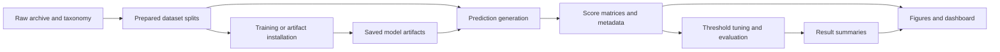

# Architecture

NALTRA separates dataset preparation, model inference, and offline evaluation.
Every model uses the same prediction contract.

## Experiment flow

A model scores an evaluation set once. Offline evaluation reuses those scores to
compare thresholds and votes without rerunning the model. Commands are in the
[runbook](runbook.md).

## Prediction flow

`PredictionPipeline` normalizes text, detects EN/TR language unless supplied by the
caller, runs one model or an ensemble, and resolves thresholds, hierarchy paths,
and out-of-distribution (OOD) status. Optional calibration and explanation hooks
are extension points; the reported experiments do not use them.

The returned `PredictionResult` contains:

| Field | Meaning |
| --- | --- |
| `text` | Normalized input |
| `model` | Model or ensemble identifier |
| `label_scores` | Complete scores over supported direct labels |
| `labels` | Threshold-selected direct labels |
| `hierarchy_paths` | Root-to-label paths for the selected labels |
| `language` | Detected or caller-supplied language information |
| `ood` | Confidence-based OOD decision, or an explicit disabled status |
| `metadata` | Label-space, taxonomy, calibration, and provenance details |

Batch predictions preserve input order. Ancestor paths do not assign invented
probabilities to parent labels.

## Module boundaries

| Module | Responsibility |
| --- | --- |
| `src/naltra/data/` | Cleaning, splits, translation, derived variants, manifests, and audits |
| `src/naltra/models/` | Training, persistence, raw scores, and service adapters |
| `src/naltra/pipeline/` | Shared text, language, thresholds, voting, hierarchy, and OOD flow |
| `src/naltra/schemas/` | Common prediction structures |
| `src/naltra/evaluation/` | Metrics, threshold tuning, bootstrap comparisons, and latency |
| `src/naltra/reporting/` | Dashboard HTML template |
| `src/naltra/utils/` | Configuration, bundled resources, and run provenance |
| `scripts/` | Repository command-line entry points |

Built wheels bundle default configuration and taxonomy resources for model
construction, artifact loading, and inference. Dataset preparation and experiment
commands use a source checkout.

## Labels and votes

Models train on `labels_direct`. Ordinary classification evaluates direct labels;
hierarchical evaluation expands predictions and targets to include ancestors.

Hard voting uses selected-label membership and treats omissions as negative votes.
Soft voting uses complete score vectors; weighted soft voting weights each member by
its validation micro-F1. A prediction without `label_scores` falls back to the scores
of its selected labels and treats omissions as zero. Members must declare compatible
dataset, track, and label spaces.

The full benchmark uses SVM, hybrid kNN, BiLSTM, and Transformer as voting members.
Naive Bayes is a non-voting baseline. Kev and Jev join the votes only on the fixed
EN/TR samples. Laya is evaluated on the same samples but does not vote. Kev answers
through a local server and Jev through TypeSafe's hosted API, with the same yes/no
questions; Laya runs a pinned multilingual checkpoint locally, one two-option question
per label. The near-OOD benchmark (humanities root held out of training) is
`scripts/run_ood.py`.

See [model usage](core_ml.md) for runtime decisions and
[evaluation](evaluation.md) for the offline protocol.
