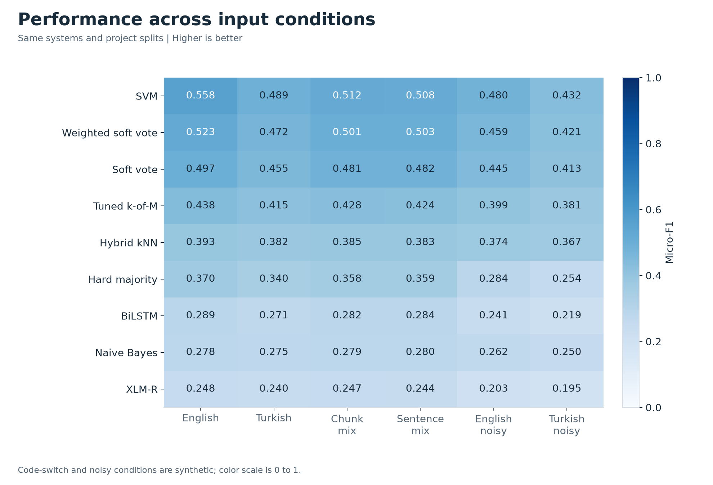
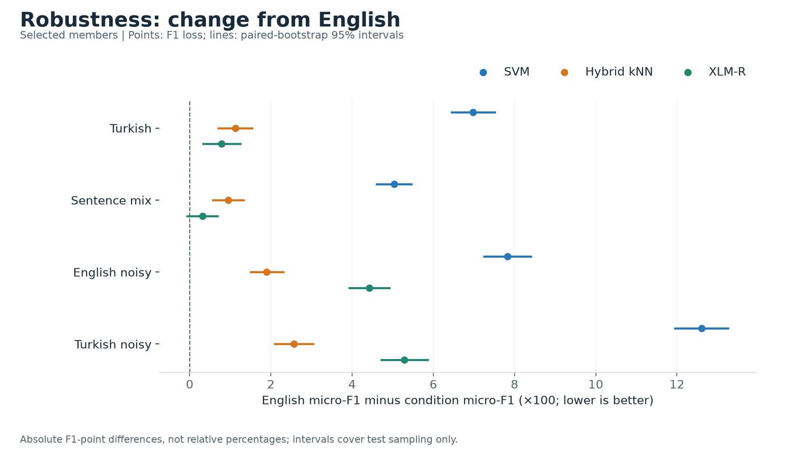
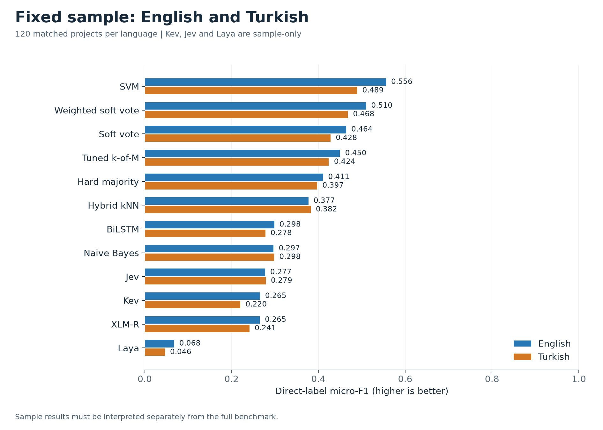
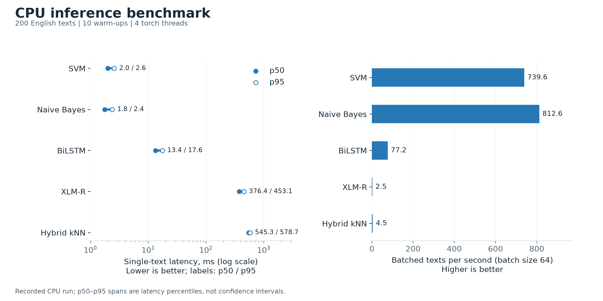
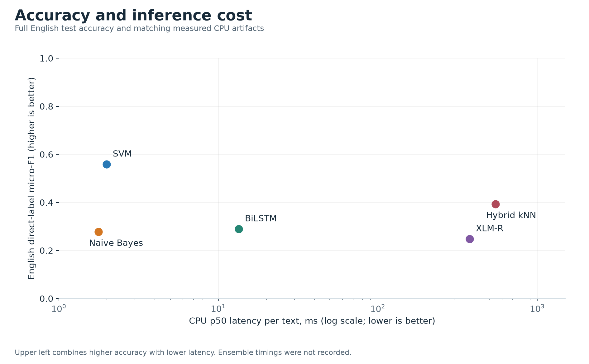
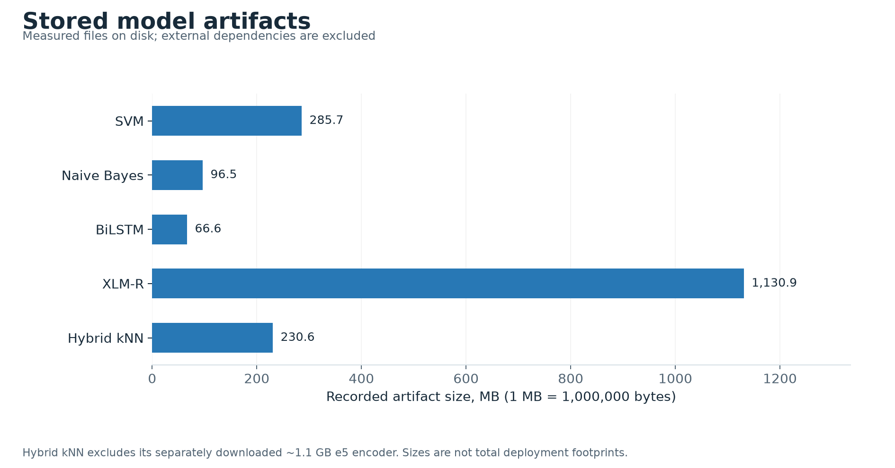
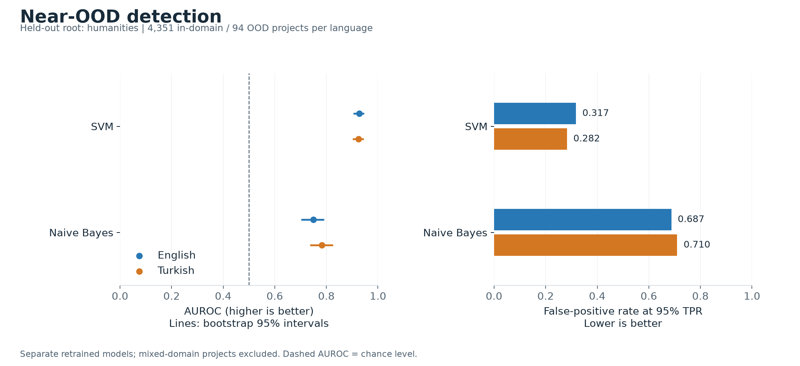

# Results

These are the recorded release 1.1.0 results. They have not been recalculated from
model artifacts during the documentation cleanup. See the [reproduction guide](reproducibility.md)
for verification status.

## Sources

| Experiment | Recorded summary |
| --- | --- |
| Full benchmark | [JSON](../results/metrics/cordis_v1.1.0_ensemble/summary.json), [tables](../results/metrics/cordis_v1.1.0_ensemble/summary.md) |
| Fixed EN/TR samples | [JSON](../results/metrics/cordis_v1.1.0_sample/summary.json), [tables](../results/metrics/cordis_v1.1.0_sample/summary.md) |
| Humanities-held-out OOD | [JSON](../results/ood/cordis_v1.1.0/summary.json) |
| Efficiency | [JSON](../results/benchmarks/cordis_v1.1.0/benchmark_summary.json), [tables](../results/benchmarks/cordis_v1.1.0/benchmark_summary.md) |

The [interactive dashboard](results/index.html) includes the full and sample
comparisons. The [evaluation guide](evaluation.md) explains the metrics.

## Full benchmark

Release 1.1.0, test sets of 4,711 projects each; thresholds tuned on validation only;
micro-F1 is the primary metric because predicting no label at all already scores
99.3% per-label accuracy ([why](evaluation.md#metrics)). The full-set
and 120-pair sample numbers with intervals are on the [results page](results/index.html).
The table shows the two best of the four votes on test; the hard votes `hard_k` and
`hard_majority` reach 0.438 and 0.370 on EN (`results/metrics/cordis_v1.1.0_ensemble/summary.md`).

| System | Role | EN | TR | Code-switch (sentence) | EN noisy | Macro-F1 EN | Hier. F1 EN | p50 CPU |
| --- | --- | --- | --- | --- | --- | --- | --- | --- |
| `svm` | baseline | **0.558** | **0.489** | **0.508** | **0.480** | **0.489** | **0.668** | 2.0 ms |
| weighted soft vote | new | 0.523 | 0.472 | 0.503 | 0.459 | 0.443 | 0.641 | - |
| soft vote | new | 0.497 | 0.455 | 0.482 | 0.445 | 0.422 | 0.628 | - |
| `hybrid_knn` | new | 0.393 | 0.382 | 0.383 | 0.374 | 0.312 | 0.545 | 545 ms |
| `bilstm` | baseline | 0.289 | 0.271 | 0.284 | 0.241 | 0.161 | 0.461 | 13.4 ms |
| `naive_bayes` | baseline | 0.278 | 0.275 | 0.280 | 0.262 | 0.198 | 0.440 | 1.8 ms |
| `transformer` | baseline | 0.248 | 0.240 | 0.244 | 0.203 | 0.119 | 0.438 | 376 ms |


The chart includes all systems with recorded direct-label micro-F1. The
hierarchy-closed hard vote has only hierarchical scores and is excluded.

### Language and noise robustness



Rows share a 0–1 color scale. Code-switch and noise are synthetic variants of the
same project splits; Turkish is machine translated.

Micro-F1 lost from English test (paired bootstrap, 95% interval, Holm):

| System | -> TR | -> code-switch (sentence) | -> EN noisy | -> TR noisy |
| --- | --- | --- | --- | --- |
| `svm` | 0.070 [0.064, 0.075] | 0.050 [0.046, 0.055] | 0.078 [0.072, 0.084] | 0.126 [0.119, 0.133] |
| `hybrid_knn` | 0.011 [0.007, 0.016] | 0.009 [0.005, 0.014] | 0.019 [0.015, 0.023] | 0.026 [0.021, 0.031] |
| `transformer` | 0.008 [0.003, 0.013] | 0.003 [-0.001, 0.007], not significant | 0.044 [0.039, 0.049] | 0.053 [0.047, 0.059] |



Points show absolute F1 loss multiplied by 100, and lines show the recorded paired
bootstrap 95% intervals. These are not relative percentage losses. An interval
crossing zero does not establish a performance drop.

## Fixed sample comparison

Zero-shot decision models on the fixed pair-hash sample (120 test project pairs, the same
projects for every system; thresholds and weights from 32 val-A pairs, ensemble settings
from 48 val-B pairs of an 80-pair validation sample). 249 of the 473 direct labels have no
positive project in the test sample and 304 none in the validation sample, so sample
macro-F1 (at most 224/473 = 0.474) is not comparable to the full test sets:

| System | Role | EN micro-F1 | TR micro-F1 | EN -> TR drop |
| --- | --- | --- | --- | --- |
| `svm` | baseline | 0.556 | 0.489 | 0.066 [0.033, 0.100] |
| weighted soft vote | new | 0.510 | 0.468 | 0.042 [0.016, 0.069] |
| `hybrid_knn` | new | 0.377 | 0.382 | -0.005 [-0.027, 0.018], not significant |
| `bilstm` | baseline | 0.298 | 0.278 | 0.020 [-0.020, 0.060], not significant |
| `naive_bayes` | baseline | 0.297 | 0.298 | -0.001 [-0.029, 0.026], not significant |
| `jev` | new | 0.277 | 0.279 | -0.002 [-0.018, 0.014], not significant |
| `kev` | new | 0.265 | 0.220 | 0.045 [0.021, 0.070] |
| `transformer` | baseline | 0.265 | 0.241 | 0.024 [-0.010, 0.057], not significant |
| `laya` | new | 0.068 | 0.046 | 0.021 [-0.005, 0.048], not significant |



The sample chart includes all recorded direct-label systems. Kev, Jev, and Laya
have no full-set results. Laya is a non-voting baseline, with its 0.98 threshold
tuned on val-A. Its low sample F1 describes this zero-shot setup; CORDIS
fine-tuning was not evaluated.

## Findings

- A calibrated linear SVM is the most accurate member on every set, and none of the tested
  votes beats it: the best ensemble (weighted soft) is 0.036 [0.031, 0.040] micro-F1 below
  it on English.
- Among the members, the most accurate loses the most micro-F1: SVM drops 0.070 on Turkish and
  0.078 on noisy English, while the multilingual retrieval member (`hybrid_knn`) drops 0.011
  and 0.019, and XLM-R's code-switch drop is not significant. Relative to its English score,
  SVM's noisy-English drop (14.0%) is smaller than BiLSTM's (16.6%) and XLM-R's (17.9%).
- Jev, not fine-tuned on CORDIS by the team (whether the provider's training data included
  CORDIS is unknown), comes within about 0.02 micro-F1 of the trained BiLSTM and Naive Bayes
  on English, scores above XLM-R (0.277 vs 0.265, untested), and shows no detectable EN -> TR
  drop (-0.002 [-0.018, 0.014], Holm p 0.85); the open Kev-0.8B is level with XLM-R on
  English but drops 0.045 on Turkish.
- The neural members are weak (macro-F1 0.16 BiLSTM, 0.12 XLM-R), and XLM-R scores below
  Naive Bayes on English (0.248 vs 0.278 micro-F1). This is a compute-budget result: XLM-R
  was fine-tuned for 3 epochs with validation loss still falling (0.0382 to 0.0345), and the
  scores match the teammate's own validation selection; no longer run was tried.
- Near-OOD (held-out humanities, 4,351 in-domain vs 94 OOD test projects): SVM AUROC 0.927
  [0.905, 0.946] EN and 0.924 [0.902, 0.945] TR; Naive Bayes 0.749 and 0.782.
- The prebuilt audit flagged 598 translation projects in the former TR 1.0.0 release; 1.1.0
  repairs them, and the audit flags 0 (`results/metrics/translation_exceptions.json`).

## Efficiency

p50 CPU is single-text latency over 200 EN test texts after 10 warm-up calls on an Intel
Core i5-9300H (CUDA hidden, 4 torch threads). Size and parameter counts in
`benchmark_summary.md` are not comparable across families: the classical and kNN counts are
stored values (all three SVM calibration folds; kNN index entries), and neither count
includes the 1.1 GB e5 encoder of `hybrid_knn`.



Latency is end-to-end single-text inference; its p50–p95 span describes timing
percentiles, not uncertainty in the mean. Throughput measures batches of up to 64
texts in the recorded CPU run. Different hardware can change these timings.



This comparison joins full-set English micro-F1 with latency for the same artifact
fingerprints. Lower latency and higher F1 place a model toward the upper left.
Ensembles and sample-only models have no recorded matching timings.



Artifact sizes use decimal MB. Hybrid kNN additionally needs its separately
downloaded e5 encoder (about 1.1 GB), which is excluded from the recorded size.
These bars describe stored artifacts, not complete deployment footprints.

## Out-of-distribution detection



These measurements use separately retrained SVM and Naive Bayes models with
humanities held out. Higher AUROC is better; lower false-positive rate at 95%
true-positive rate is better. AUROC lines show the recorded bootstrap 95%
intervals. Each language has 4,351 in-domain and 94 OOD projects; 266 mixed-domain
projects are excluded. This tests one near-OOD setting.

## Regenerate the charts

From the repository root, in the installed project environment:

```bash
python scripts/plot_results.py
```

This reads the four committed summaries and writes eight PNG charts plus SVG
versions to [the figure folder](figures/cordis_v1.1.0/). The
[manifest](figures/cordis_v1.1.0/manifest.json) records source paths and SHA-256
checksums. Use SVG files for scalable exports. Charts visualize archived results;
this command does not rerun inference or evaluation and needs no model files.

The script checks matching taxonomies, test inputs and accuracy/latency artifacts
before writing. Input and output paths can be changed with `--full`, `--sample`,
`--benchmark`, `--ood` and `--output-dir`; inputs must retain the release schema.
Confusion and calibration plots require the prediction dumps and use
`make_figures.py` instead ([runbook](runbook.md#full-results-from-archived-predictions)).

## Limitations

- **Labels and text.** CORDIS labels are semi-automatic (silver). The Turkish text is machine
  translation without human review; the code-switched and noisy sets are synthetic.
- **OOD scope.** One held-out root (humanities: 94 OOD vs 4,351 in-domain test projects),
  only `naive_bayes` and `svm` retrained, no far-OOD set; the 266 test projects with both
  humanities and other labels are excluded as ambiguous, so mixed-domain projects are untested.
- **Cleaning loss.** The step-3 tag pattern also deletes `<…>` spans that are comparisons,
  not HTML (`after (z<3) and before (z>3)` becomes `after (z 3)`): 62 retained projects (48
  train, 5 validation, 9 test) lose 17,290 characters. Labels are unaffected; dropping the 9
  test projects moves each member's full-set EN micro-F1 by at most 0.0002 (at most 0.003 on
  the 120-pair sample, which holds 2 of them), and the effect of the lost
  training text is not measured. The 1.1.0 text is hash-locked, so a corrected cleaner needs
  a new release version and a re-evaluation of every member.
- **Single training run.** Every trained member is one run with seed 42, so the bootstrap
  intervals cover test-set sampling only, not training variance.
- **Label universe.** The >= 50-project support filter that defines the 473 labels counts
  all projects in the archive, test projects included (`scripts/build_taxonomy.py`), so the
  test split influenced which labels exist, though no model trains on it.
- **Validation reuse.** Member hyperparameters (NB alpha, neural checkpoints, head-refit
  candidates) were chosen on the full validation set, including the val-B half that tunes
  the ensembles, so ensemble settings may be slightly optimistic. Test sets were only scored.
- **Soft votes** average raw member scores on different scales (Platt probabilities,
  neighbour-vote fractions, sigmoid outputs, p(yes)); tuned thresholds are 0.12-0.16 for
  the voting trained members and 0.88 for Kev and Jev (the non-voting Naive Bayes: 0.22 on
  the full sets, 0.16 on the sample).
- **Neural training budget.** XLM-R's row measures a 3-epoch budget, not the architecture's
  ceiling. The `xlm-roberta-base` revision was not recorded; the fine-tuned weights are in
  the artifact.
- **Sample-only members.** Kev, Jev and Laya run only on the 80 validation and 120 test pairs;
  Jev's `jev-latest` is a hosted alias whose weights can change, and the Kev dumps record the
  service configuration, not the served weights.
- **Near-duplicates.** Grouping catches only identical texts: 6, 15 and 25 of the 4,711 EN
  test projects have a training project at TF-IDF cosine of at least 0.95, 0.9 and 0.8
  (EN-train word 1-2-grams, min_df 2, sublinear tf; 7, 16 and 25 with the 50k vocabulary).
